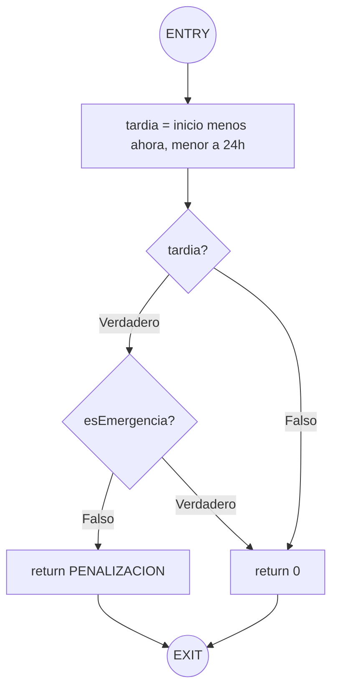

# Grafo de flujo de control: calcularPenalizacion

Funcion que se analiza (src/reglas.js):

```javascript
function calcularPenalizacion(inicio, ahora, esEmergencia) {
  const tardia = inicio - ahora < HORAS_LIMITE_CANCELACION * MS_POR_HORA;
  if (tardia && !esEmergencia) {
    return PENALIZACION;
  }
  return 0;
}
```

## Diagrama

GitHub dibuja este diagrama solo con abrir el archivo.



## Nodos y aristas

| Tipo | Elementos | Cantidad |
|---|---|---|
| Nodos (N) | ENTRY, N1, P1, P2, R1, R2, EXIT | 7 |
| Aristas (E) | ENTRY a N1, N1 a P1, P1 a P2, P1 a R2, P2 a R1, P2 a R2, R1 a EXIT, R2 a EXIT | 8 |
| Nodos predicado (P) | P1 (tardia) y P2 (esEmergencia) | 2 |

## Las tres formulas de McCabe dan lo mismo

| Formula | Calculo | V(G) |
|---|---|---|
| E - N + 2 | 8 - 7 + 2 | 3 |
| P + 1 | 2 + 1 | 3 |
| Regiones | 2 areas cerradas + 1 exterior | 3 |

ESLint tambien reporta 3 para esta funcion (`npm run complejidad`).

## Caminos independientes y su test

| Camino | Recorrido | Resultado | Test |
|---|---|---|---|
| 1 | ENTRY, N1, P1 falso, R2, EXIT | 0 | cancelar con tiempo no cobra |
| 2 | ENTRY, N1, P1 verdadero, P2 falso, R1, EXIT | 15 | cancelar tarde sin emergencia cobra |
| 3 | ENTRY, N1, P1 verdadero, P2 verdadero, R2, EXIT | 0 | cancelar tarde con emergencia no cobra |

Los tests estan en tests/reglas.test.js. Hay un cuarto test, el de exactamente 24 horas, que no es un camino nuevo: prueba el limite de la condicion de P1.
